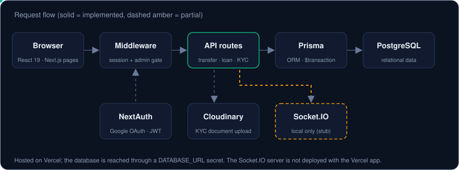
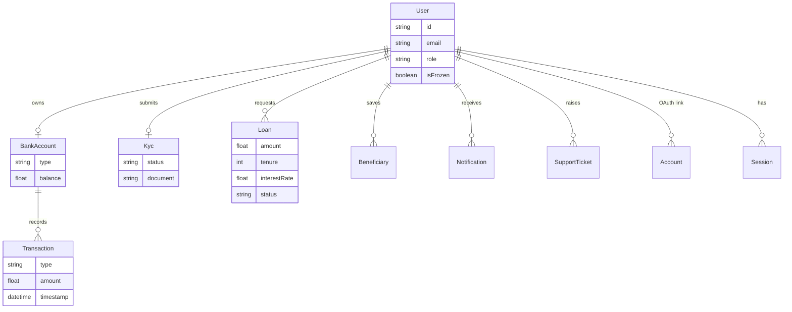
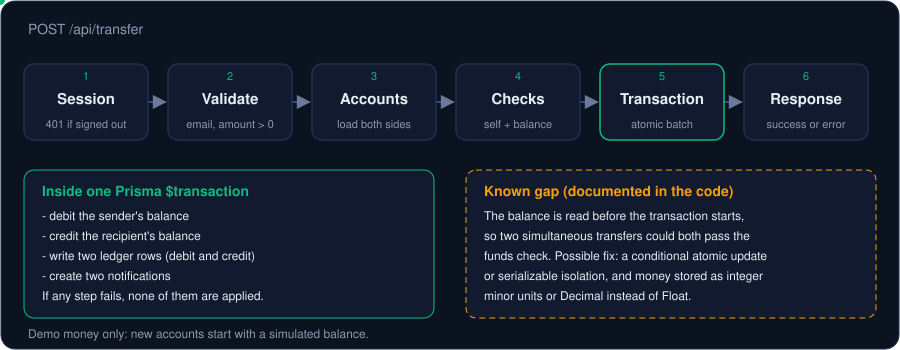
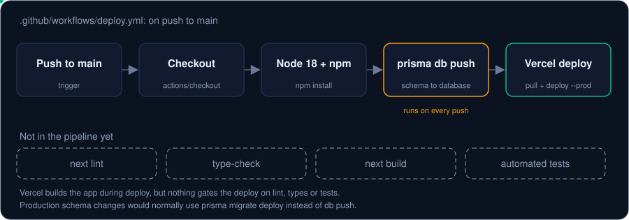

# FinSphere: Smart Banking Platform

**A banking-style full-stack web app built with Next.js 15, TypeScript, Prisma and PostgreSQL**

> Portfolio project by [Ayush Upadhyay](https://github.com/A-yushupadhyay). It is not a real bank: it uses simulated money (new accounts start with a demo balance) and should not be used with real financial data.



[**Live demo**](https://finsphere-gamma.vercel.app/) &nbsp;·&nbsp; [Screenshots](#screenshots) &nbsp;·&nbsp; [Features](#features) &nbsp;·&nbsp; [Architecture](#architecture) &nbsp;·&nbsp; [Run locally](#run-locally)

## Overview

FinSphere lets users sign in with Google, get a demo savings account, transfer money to other users by email, manage beneficiaries, apply for loans, upload KYC documents, raise support tickets and see their activity in charts. Admins get a console to approve KYC, review loans and freeze accounts.

I built it to practise the parts of a full-stack product that tutorials skip: authentication boundaries, role-based access, relational data modelling, a money-transfer path that must not half-apply, and deployment automation. Where the implementation is incomplete I say so below.

---

## Screenshots

<table>
  <tr>
    <td width="50%"><a href="https://github.com/user-attachments/assets/f8cfd79f-d4d8-444d-be4e-cebedfe00216"></a></td>
    <td width="50%"><a href="https://github.com/user-attachments/assets/6b371f0f-93e7-4a8c-a87d-01f66d8e49fd"></a></td>
  </tr>
  <tr>
    <td width="50%"><a href="https://github.com/user-attachments/assets/528b7fe1-ae3b-41b6-8a89-5c29513b93b3"></a></td>
    <td width="50%"><a href="https://github.com/user-attachments/assets/1061267d-9dab-4535-b4a4-a1eb4138d0ee"></a></td>
  </tr>
  <tr>
    <td width="50%"><a href="https://github.com/user-attachments/assets/bd4afa47-a5e4-4aeb-a41b-89403858e120"></a></td>
    <td width="50%"><a href="https://github.com/user-attachments/assets/94a973fe-11d9-4c30-8c85-42980d1bad3c"></a></td>
  </tr>
  <tr>
    <td width="50%"><a href="https://github.com/user-attachments/assets/a7582929-407d-4227-8734-fea05e552175"></a></td>
    <td width="50%"><a href="https://github.com/user-attachments/assets/69d69a3c-2b60-4882-8c7a-77260a3b7dbc"></a></td>
  </tr>
</table>

<sub>Click any image to enlarge.</sub>

---

## Features

Status is based on the code in this repository: **Implemented** means the code exists and I read it; **Pages present** means the route exists in the app; **Partial** means it only works in part.

### Product experience
| Feature | Status |
|---|---|
| Dashboard with overview, analytics chart (Recharts) and transaction feed | Pages present |
| Money transfer to another user by email | Implemented |
| Beneficiaries, loans, notifications, profile, settings, support tickets | Pages present |
| KYC document upload (Cloudinary) | Pages present |
| Animated, responsive UI (Tailwind CSS, Framer Motion) | Pages present |

### Authentication and access control
| Feature | Status |
|---|---|
| Google sign-in with NextAuth, JWT sessions and the Prisma adapter | Implemented |
| Route protection for `/dashboard` and related paths via middleware | Implemented |
| `user` and `admin` roles; admin pages gated in middleware and admin API checked server-side | Implemented |
| Admin console: approve KYC, review loans, freeze or unfreeze users | Pages and API routes present |

### Backend and data
| Feature | Status |
|---|---|
| Next.js route handlers under `src/app/api/` (account, transfer, loan, KYC, notifications, support, admin) | Implemented |
| Prisma schema with 11 models (users, bank accounts, ledger, KYC, loans, and more) | Implemented |
| Real-time balance and freeze toasts over Socket.IO | Partial: works locally only |

### Engineering workflow
| Feature | Status |
|---|---|
| GitHub Actions deploy to Vercel on push to `main`, secrets in GitHub Secrets | Implemented (deploy only) |
| Docker and Render configuration | Partial: see [limitations](#known-limitations) |
| Automated tests | Not yet |

---

## Tech stack

| Layer | Technology |
|---|---|
| Framework | Next.js 15 (App Router), React 19, TypeScript |
| Styling and UI | Tailwind CSS, Framer Motion, Recharts, lucide-react, react-hot-toast |
| Auth | NextAuth v4 (Google provider, JWT sessions, Prisma adapter) |
| Database | PostgreSQL with Prisma ORM |
| File storage | Cloudinary (KYC documents) |
| Real-time | Socket.IO with an Express server (`server.mjs`), local only |
| Deployment | Vercel via GitHub Actions; Docker and Render files present |
| Tooling | npm, ESLint |

---

## Architecture



- **Middleware** protects `/dashboard`, `/transfer`, `/profile` and `/admin` paths and redirects non-admins away from `/dashboard/admin`.
- **API routes** check the session again on the server, because the middleware only guards page navigation. For example, `POST /api/transfer` returns 401 without a session, and `POST /api/admin/freeze-user` returns 403 for non-admins.
- **Prisma** is the only code that talks to PostgreSQL, through a single shared client in `src/lib/db.ts`.

### Data model



---

## Engineering decisions and challenges

- **Balance plus ledger.** Each account stores a balance, and every movement also writes a `Transaction` row (debit or credit), so history can be audited separately from the current number.
- **Defence in depth for roles.** The role lives in the JWT and is checked twice: in middleware for pages and again inside admin API handlers, so hiding a link is never the only protection.
- **Notifications are stored in the database.** They do not depend on a live socket, so a user who is offline still sees them next time.
- **Atomic multi-write transfers.** The transfer path groups all its writes into one Prisma transaction. The flow is below, including a gap I know about.

### Money transfer flow



The debit, credit, ledger rows and notifications commit together or not at all. The balance check, however, reads the balance before the transaction begins, so two simultaneous transfers could both pass it. A production fix would use a conditional atomic update (or serializable isolation) and store money as integer minor units or `Decimal`; today the schema uses `Float`.

---

## CI/CD and deployment



`.github/workflows/deploy.yml` runs on every push to `main`. It installs dependencies, runs `prisma db push` against the database in `RAILWAY_DATABASE_URL`, and deploys to Vercel using `VERCEL_TOKEN`. Secrets live in GitHub Secrets.

This is a **deployment** workflow, not yet a full CI pipeline: nothing lints, type-checks or tests before it deploys. `prisma db push` is also better suited to development than production; the repository has a `prisma/migrations` folder, so `prisma migrate deploy` is the safer production step.

---

## Security

**Implemented**
- Google OAuth sign-in with server-side JWT sessions (NextAuth).
- Page-level route protection and admin role checks, repeated server-side in admin APIs.
- Basic input validation on transfers (recipient email, positive numeric amount, no self-transfer, sufficient balance).
- Secrets supplied through environment variables and GitHub Secrets, with an `.env.example` using placeholders.

**Hardening still needed** (this is a demo, not a bank)
- Make balance updates race-safe and move money to `Decimal` or integer minor units.
- Add schema validation (for example Zod) and rate limiting on API routes.
- Move admin promotion from code to configuration.
- Protect or remove the unauthenticated `/trigger` endpoint and open CORS in `server.mjs`.
- Add automated tests, including transfer edge cases.

---

## Run locally

**Prerequisites:** Node.js 18.18+ (the Docker image uses Node 18), a PostgreSQL database, a Google OAuth client, and a Cloudinary account for KYC uploads.

```bash
# 1. Clone
git clone https://github.com/A-yushupadhyay/Finsphere.git
cd Finsphere

# 2. Install dependencies
npm install

# 3. Configure environment
cp .env.example .env.local      # then fill in your own values

# 4. Create the database tables
npx prisma migrate deploy

# 5. Start the dev server
npm run dev                     # http://localhost:3000
```

If `migrate deploy` leaves tables missing, use `npx prisma db push` on a **local throwaway database only**, never on production data.

**Environment variables** (see `.env.example`): `DATABASE_URL`, `NEXTAUTH_SECRET`, `NEXTAUTH_URL`, `GOOGLE_CLIENT_ID`, `GOOGLE_CLIENT_SECRET`, `CLOUDINARY_CLOUD_NAME`, `CLOUDINARY_API_KEY`, `CLOUDINARY_API_SECRET`.

**Optional: real-time toasts.** Run `node server.mjs` in a second terminal (Socket.IO on port 3001). The client currently connects to `localhost:3001`.

**Validation commands that exist:** `npm run lint` and `npm run build`. The first sign-in creates a savings account with a simulated ₹10,000 balance.

**Troubleshooting**
- *Google sign-in redirect error:* add `http://localhost:3000/api/auth/callback/google` as an authorised redirect URI in your Google OAuth client.
- *Prisma client errors:* run `npx prisma generate`.
- *No balance toasts:* start `node server.mjs`.

---

## Project structure

```
Finsphere/
├── src/
│   ├── app/              # App Router: pages (login, dashboard/*) and api/* route handlers
│   ├── components/       # AppShell, Sidebar, Navbar, TransactionChart, TransactionFeed, KycUpload, ui/
│   ├── lib/              # auth.ts, db.ts, cloudinary.ts, socket.ts, utils.ts
│   ├── types/
│   └── middleware.ts     # session and admin route protection
├── prisma/               # schema.prisma and migrations/
├── scripts/              # makeAdmin.ts
├── server.mjs            # standalone Socket.IO server
├── Dockerfile, docker-compose.yml, .render.yaml
└── .github/workflows/deploy.yml
```

---

## Known limitations

- Money is stored as `Float` and the transfer balance check is not race-safe (see above).
- Real-time updates only work locally: the client and the admin freeze route point at `localhost:3001`, which is not deployed with the Vercel app.
- The `Dockerfile` starts `server.mjs` only, so the container does not serve the Next.js app as written.
- There are no automated tests, and the workflow does not lint or test before deploying.
- Several pages and API routes (loans, KYC, support, beneficiaries) are present but were not individually reviewed for this README.

## Roadmap

Planned, not built yet:
- Race-safe transfers and `Decimal` money
- Lint, type-check, build and test jobs in CI; `prisma migrate deploy` for production
- Fix the Docker setup
- Deployable real-time notifications
- Finer-grained role-based access control
- AI finance assistant and real-time transaction analytics
- Automated changelog and release notes

## Contributing

Pull requests are welcome. For major changes, please open an issue first.

## License

MIT, see [LICENSE](LICENSE). Copyright (c) 2025 Ayush Upadhyay.
